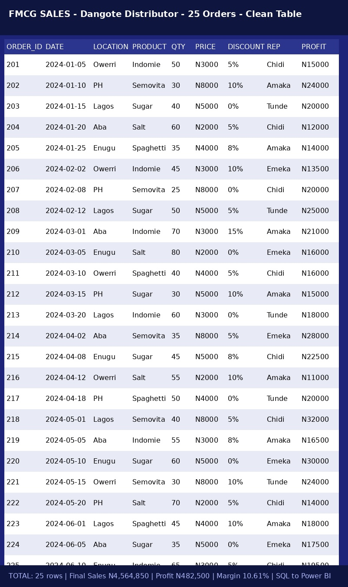

# FMCG Dangote Distributor Sales - Owerri & Lagos Region

## Overview
25 orders | Dangote Sugar, Salt, Semovita, Indomie Noodles, Spaghetti | 5 Locations: Lagos, Enugu, Aba, PH, Owerri | SQL to Power BI

## Key Metrics
- Total Final Sales: ₦4,564,850 (after discount)
- Total Profit: ₦482,500
- Average Profit Margin: 10.61%
- Top Sales Rep: Chidi
- Top Location: Lagos
- Top Product: Dangote Sugar (35%)

## Dashboard

## Data Table (25 Orders)

## DAX Formulas Used
- TOTAL_SALES = QUANTITY * PRICE
- FinalSales = TOTAL_SALES * (1 - DISCOUNT)
- PROFIT_MARGIN = DIVIDE(PROFIT, FINAL_SALES, 0)
- ProfitMargin Measure = DIVIDE(SUM(PROFIT), SUM(FINAL_SALES), 0)

## Tech Stack
SQL -> Power BI -> DAX -> Naira Formatting -> GitHub
